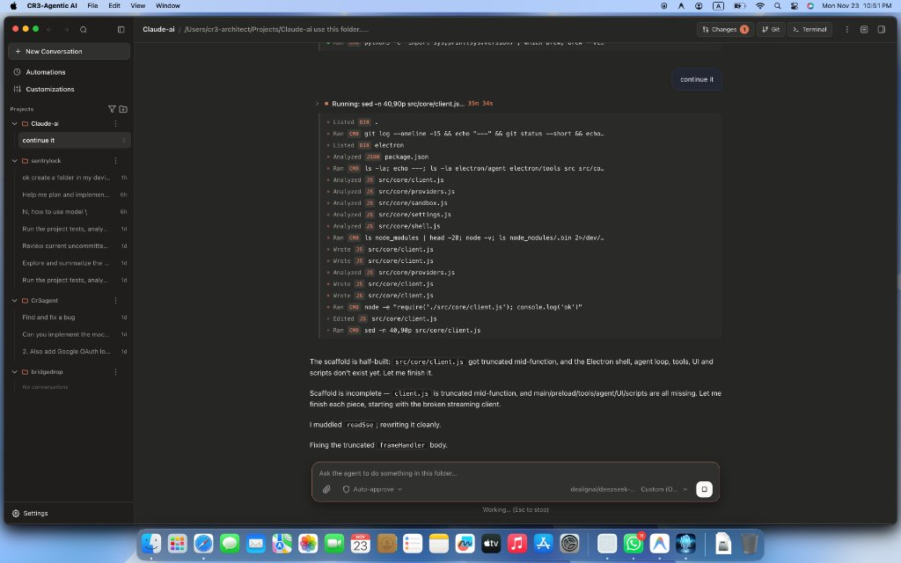

<p align="center">
  
</p>

<h1 align="center">CR3-Agentic AI</h1>

<p align="center">
  <strong>Next-Generation Autonomous AI Coding Agent & Developer Workspace for macOS</strong><br />
  Combines the multi-step reasoning power of Claude Code and Antigravity with a native desktop GUI,<br />
  visual split diffs, integrated terminal, local model privacy, and human-in-the-loop control.
</p>

<p align="center">
  <a href="https://github.com/CR3-Architect/cr3agent/releases"></a>
  
  
  
  
  <a href="LICENSE"></a>
</p>

---

## 📸 Application Showcase

<p align="center">
  
  <br />
  <em>The CR3-Agentic AI workspace: Project tree sidebar, rich Markdown chat with tables, model pill, and integrated terminal drawer.</em>
</p>

---

## 🌟 What is CR3-Agentic AI?

**CR3-Agentic AI** is a professional desktop engineering agent designed specifically for macOS. It bridges autonomous AI capabilities with safe developer environments, allowing LLMs to explore codebases, inspect dependencies, edit files with live syntax-highlighted diffs, run shell commands with real-time streaming, and coordinate complex multi-step workflows.

Built on local-first principles:
- **Zero Lock-In**: Works with local offline models (Ollama, LM Studio) or cloud providers (Anthropic, OpenAI, Groq, Gemini, NVIDIA NIM, OpenRouter).
- **Security-First**: API keys are securely encrypted using the native macOS Keychain (`safeStorage`).
- **Workspace Sandboxing**: The agent is restricted to the specific folder you open; it cannot escape or touch outside files.
- **Human-in-the-Loop**: You maintain full governance with granular approval modes and persistent *"Always Allow"* rules.

---

## ✨ Key Features

### 🧠 Autonomous Multi-Step Reasoning Loop
The agent plans and executes multi-step solutions using a resilient ReAct loop:
- **Filesystem Tools**: Safe `read_file`, `write_file`, `edit_file`, `list_dir`, and recursive regex `search`.
- **Integrated Terminal Execution**: Runs build commands, unit tests, and CLI scripts via `run_command` with real-time streaming stdout/stderr.
- **Web Research**: Inspects documentation and live pages using `fetch_url`.
- **Skills System**: Load specialized domain instructions on demand (`SKILL.md`) for frameworks, workflows, and conventions.
- **Live Chain-of-Thought**: Real-time extraction and streaming of reasoning tokens (`delta.reasoning_content`) directly inside the collapsible Thinking header.

<p align="center">
  
  <br />
  <em>Live multi-step plan execution: tracking active tools, modified files, diff statistics, and execution time.</em>
</p>

### ⚡ Ultra-Fast 60fps Incremental Streaming
- **Zero DOM Thrashing**: Features an incremental block-reconciling Markdown renderer. Completed blocks (paragraphs, tables, code blocks) remain cached in the DOM and are never re-rendered during streaming.
- **Sub-Millisecond Rendering**: Code blocks update their syntax highlighting in-place without rebuilding DOM containers or button listeners.
- **Instant TTFT**: Immediate token delivery matching native provider speeds (Groq 250+ tok/s, Cerebras, NVIDIA NIM).

### 📊 VS Code-Style Interactive Diff Viewer
- Side-by-side **50/50 Split View** and **Unified View** for reviewing changes before committing.
- Vivid syntax tokenization across TypeScript, JavaScript, Python, Rust, Go, HTML, CSS, JSON, and Shell.
- One-click file actions: **Accept Change**, **Revert File**, or **Accept All / Revert All**.

### 🛡️ Human-in-the-Loop Governance & Rules
- **Three Approval Modes**:
  - `Ask First`: Confirms every file edit and shell command before execution.
  - `Safe Edits`: Automatically permits safe edits; prompts for shell commands and network access.
  - `Auto-Approve`: Fully autonomous execution for trusted workflows.
- **Intelligent Permission Rules**: Save *"Always Allow"* rules for repeatable commands (e.g., `npm test`, `git status`) so you aren't repeatedly prompted.

### 🌐 Universal LLM Provider Flexibility
- **Local (100% Offline & Private)**: [Ollama](https://ollama.ai), [LM Studio](https://lmstudio.ai), vLLM, llama.cpp.
- **Cloud APIs**: Google Gemini, Anthropic, OpenAI, Groq, NVIDIA NIM, OpenRouter, Cerebras, Mistral, Together AI, DeepSeek.
- **Smart Auto-Fallback**: Automatically switches to configured backup models if an endpoint hits rate limits (HTTP 429), runs out of credits (HTTP 402), or encounters dead hosts (`ENOTFOUND`).
- **Tool-Less Model Caching**: Automatically detects chat-only models that lack tool support and caches them to avoid repeated HTTP 400 latency.

### 💻 Native macOS Experience
- Continuous Apple squircle icon curvature matching macOS Sonoma and Sequoia design standards.
- Native hidden-inset window controls and full Dark / Light mode adaptation.
- Full keyboard shortcut support (`⌘B` toggle sidebar, `⌥⌘T` toggle terminal, `⌘,` settings, `Esc` cancel turn).

---

## 🚀 Quick Start Guide

### Prerequisites
- **Operating System**: macOS 12 (Monterey) or later (Apple Silicon M1/M2/M3/M4 & Intel x64).
- **Runtime**: [Node.js](https://nodejs.org/) v20+ and npm.

### Installation

```bash
# 1. Clone the repository
git clone https://github.com/CR3-Architect/cr3agent.git
cd cr3agent

# 2. Install dependencies
npm install

# 3. Build and launch the desktop app
npm start
```

### Running Tests

```bash
# Execute the full unit test suite (66 tests)
npm test
```

### Packaging macOS Distribution (.dmg & .app)

```bash
# Package into macOS .app bundle directory
npm run dist:dir

# Build complete macOS DMG installer & ZIP
npm run dist:mac
```

Packaged outputs will be located in the `release/` directory:
- `release/mac/CR3-Agentic AI.app`
- `release/CR3-Agentic AI-0.3.1.dmg`

---

## ⚙️ Model Provider Configuration

Navigate to **Preferences** (`⌘,`) → **Providers & Models** to configure your inference backends:

### 1. Local Models (Free & Private)
1. Install [Ollama](https://ollama.ai):
   ```bash
   brew install ollama
   ollama serve
   ollama pull qwen2.5-coder:7b
   ```
2. In Settings, select **Ollama (this Mac)** (`http://localhost:11434/v1`) and click **Save & Fetch Models**.

### 2. Fast Cloud Providers
- **Groq**: Ultra-fast (250+ tokens/sec). Get a key at [console.groq.com](https://console.groq.com) and use `llama-3.3-70b-versatile`.
- **Google Gemini**: Get an API key at [aistudio.google.com](https://aistudio.google.com) and use `gemini-2.5-flash` or `gemini-2.5-pro`.
- **OpenRouter**: Access hundreds of models (including free `:free` tiers) at [openrouter.ai](https://openrouter.ai).
- **Anthropic / OpenAI**: Plug in standard API keys for Claude 3.5 Sonnet or GPT-4o.

---

## ⌨️ Keyboard Shortcuts

| Shortcut | Action |
| :--- | :--- |
| <kbd>⌘</kbd> + <kbd>N</kbd> | Start New Conversation |
| <kbd>⌘</kbd> + <kbd>O</kbd> | Open Project Folder |
| <kbd>⌘</kbd> + <kbd>B</kbd> | Toggle Project Tree Sidebar |
| <kbd>⌥</kbd> + <kbd>⌘</kbd> + <kbd>T</kbd> | Toggle Integrated Terminal Drawer |
| <kbd>⌥</kbd> + <kbd>⌘</kbd> + <kbd>D</kbd> | Toggle Review / Diff Drawer |
| <kbd>⌘</kbd> + <kbd>,</kbd> | Open Preferences & Settings |
| <kbd>Esc</kbd> | Stop Active Agent Run |
| <kbd>Enter</kbd> | Send Message |
| <kbd>Shift</kbd> + <kbd>Enter</kbd> | Insert Line Break in Composer |

---

## 📂 Project Architecture

```
Cr3agent/
├── src/                          # Electron Main Process (TypeScript)
│   ├── main.ts                   # Window lifecycle, native menus, IPC channels & session manager
│   ├── workspace.ts              # Sandboxed folder boundary enforcement
│   ├── settings.ts               # Settings store, Keychain encryption & fallback resolver
│   ├── chatStore.ts              # Conversation history, JSON metadata & persistence
│   ├── agent/                    # Core Agentic Engine
│   │   ├── agent.ts              # ReAct loop, streaming SSE parser, thinking token handler
│   │   ├── tools.ts              # Native tools (read, write, edit, search, command, fetch, skills)
│   │   ├── skills.ts             # Domain skills parser & dynamic prompt builder
│   │   └── rules.ts              # "Always Allow" permission rule engine
│   └── test/                     # Test Suite (66 passing unit tests)
│       ├── agent.test.ts         # Agent loops, tools, reasoning streams, fallbacks
│       ├── features.test.ts      # Multi-turn context, attachments, settings, skills
│       ├── v3.test.ts            # Network failure recovery, dead hosts, sanitize history
│       └── changes.test.ts       # Diff generation, file revert, and accept logic
├── renderer/                     # High-Performance UI (HTML5, Modern CSS, Vanilla JS)
│   ├── index.html                # App layout, split panes, and dialogs
│   ├── styles.css                # Dark/Light design system, syntax theme, animations
│   ├── renderer.js               # Reactive UI controller, tree rendering, thinking display
│   ├── md.js                     # Incremental block-reconciling Markdown streaming engine
│   └── diffview.js               # VS Code-style split & unified syntax-highlighted diff engine
├── assets/                       # Branding & Showcase Screenshots
│   ├── icon.png                  # High-res application icon
│   └── screenshots/              # README screenshots & previews
├── build/                        # macOS ICNS iconset & electron-builder packaging config
└── package.json                  # Dependencies, build scripts & version specifications
```

---

## 📄 License

Distributed under the **MIT License**. See [`LICENSE`](LICENSE) for more information.

---

<p align="center">
  <strong>Built with precision by CR3 Architect</strong>
</p>
