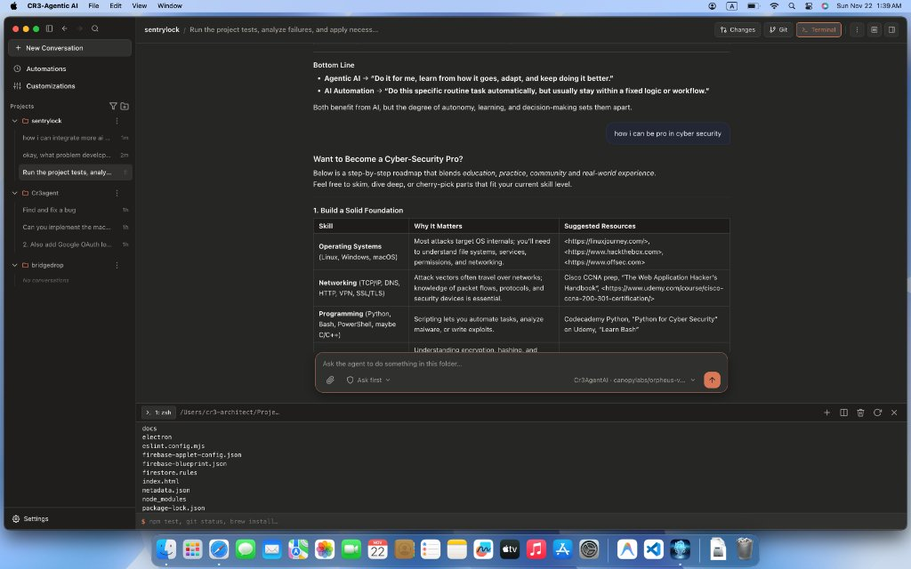

<p align="center">
  
</p>

<h1 align="center">CR3-Agentic AI</h1>

<p align="center">
  <strong>Next-Generation Autonomous AI Coding Agent & Developer Workspace for macOS</strong><br />
  Combines the multi-step reasoning power of Claude Code and Antigravity with a native desktop GUI,<br />
  visual split diffs, integrated terminal, local model privacy, and human-in-the-loop governance.
</p>

<p align="center">
  <a href="https://github.com/CR3-Architect/cr3agent/releases"></a>
  
  
  
  
  <a href="LICENSE"></a>
</p>

---

## Application Showcase

<p align="center">
  
  <br />
  <em>The CR3-Agentic AI workspace: Project tree sidebar, formatted Markdown conversation, model selection pill, and integrated terminal drawer.</em>
</p>

---

## Overview

CR3-Agentic AI is a professional desktop engineering agent designed specifically for macOS. It bridges autonomous AI capabilities with safe developer environments, allowing LLMs to explore codebases, inspect dependencies, edit files with live syntax-highlighted diffs, run shell commands with real-time streaming, and coordinate complex multi-step workflows.

Built on local-first principles:
- **Zero Lock-In**: Works with local offline models (Ollama, LM Studio) or high-performance cloud providers (NVIDIA NIM, Groq, Anthropic, OpenAI, Google Gemini, OpenRouter).
- **Security-First**: API keys are securely encrypted using the native macOS Keychain (`safeStorage`).
- **Workspace Sandboxing**: The agent is restricted to the specific project directory you open; it cannot escape or modify outside files.
- **Human-in-the-Loop**: You maintain full governance with granular approval modes and persistent "Always Allow" permission rules.

---

## Key Features

### Autonomous Multi-Step Reasoning Engine
The agent plans and executes multi-step solutions using a resilient ReAct loop:
- **Filesystem Tools**: Safe `read_file`, `write_file`, `edit_file`, `list_dir`, and recursive regex `search`.
- **Integrated Terminal Execution**: Runs build commands, unit tests, and CLI scripts via `run_command` with real-time streaming stdout/stderr.
- **Web Research**: Inspects documentation and live pages using `fetch_url`.
- **Skills System**: Load specialized domain instructions on demand (`SKILL.md`) for frameworks, workflows, and conventions.
- **Live Chain-of-Thought**: Real-time extraction and streaming of reasoning tokens (`delta.reasoning_content`) directly inside the collapsible Thinking header.

<p align="center">
  
  <br />
  <em>Live multi-step plan execution: tracking active tools, modified files, diff statistics, and execution time.</em>
</p>

### Ultra-Fast 60fps Incremental Streaming
- **Zero DOM Thrashing**: Features an incremental block-reconciling Markdown renderer. Completed blocks (paragraphs, tables, code blocks) remain cached in the DOM and are never re-rendered during streaming.
- **Sub-Millisecond Rendering**: Code blocks update their syntax highlighting in-place without rebuilding DOM containers or button listeners.
- **Instant TTFT**: Immediate token delivery matching native provider speeds (Groq 250+ tok/s, NVIDIA NIM, Cerebras).

### VS Code-Style Interactive Diff Viewer
- Side-by-side 50/50 Split View and Unified View for reviewing changes before committing.
- Syntax tokenization across TypeScript, JavaScript, Python, Rust, Go, HTML, CSS, JSON, and Shell.
- One-click file actions: Accept Change, Revert File, or Accept All / Revert All.

### Human-in-the-Loop Governance & Rules
- **Three Approval Modes**:
  - `Ask First`: Confirms every file edit and shell command before execution.
  - `Safe Edits`: Automatically permits safe edits; prompts for shell commands and network access.
  - `Auto-Approve`: Fully autonomous execution for trusted workflows.
- **Intelligent Permission Rules**: Save "Always Allow" rules for repeatable commands (e.g., `npm test`, `git status`) so you aren't repeatedly prompted.

### Universal Model Provider Support
- **NVIDIA NIM (NVIDIA API)**: Direct integration with NVIDIA's hosted inference microservices (`https://integrate.api.nvidia.com/v1`). Run high-parameter models like `meta/llama-3.3-70b-instruct`, `deepseek-ai/deepseek-r1`, and `nvidia/llama-3.1-nemotron-70b-instruct` using free developer credits from build.nvidia.com.
- **Groq**: Ultra-fast inference (250+ tokens/sec) on Llama 3.3 models with full tool-calling support.
- **Local (Offline & Private)**: Ollama, LM Studio, vLLM, and llama.cpp on `localhost`.
- **Cloud APIs**: Google Gemini, Anthropic, OpenAI, OpenRouter, Cerebras, Mistral, Together AI, DeepSeek.
- **Smart Auto-Fallback**: Automatically switches to configured backup models if an endpoint hits rate limits (HTTP 429), runs out of credits (HTTP 402), or encounters dead hosts (`ENOTFOUND`).
- **Tool-Less Model Caching**: Automatically detects chat-only models that lack tool support and caches them to avoid repeated HTTP 400 latency.

### Native macOS Integration
- Continuous Apple squircle icon curvature matching macOS Sonoma and Sequoia design standards.
- Native hidden-inset window controls and full Dark / Light mode adaptation.
- Full keyboard shortcut support (`Cmd + B` toggle sidebar, `Option + Cmd + T` toggle terminal, `Cmd + ,` settings, `Esc` cancel turn).

---

## Configuration & Settings (`settings.json`)

All persistent application settings, provider credentials, and permission rules are managed via a single configuration file stored in your macOS Application Support directory:

```bash
~/Library/Application Support/CR3-Agentic AI/settings.json
```

API keys entered through the GUI are automatically encrypted using the macOS Keychain (`safeStorage`). You can also configure or inspect providers directly.

### Complete `settings.json` Example

Below is a complete, production-ready example demonstrating how to configure multiple providers, including **NVIDIA NIM (NVIDIA API)**, **Groq**, **OpenRouter**, and **Local Ollama**, alongside automated fallbacks and permission rules:

```json
{
  "version": 2,
  "activeProviderId": "nvidia-nim",
  "approvalMode": "ask",
  "maxSteps": 25,
  "maxContextChars": 24000,
  "autoFallback": true,
  "persona": "software",
  "onboarded": true,
  "providers": [
    {
      "id": "nvidia-nim",
      "name": "NVIDIA NIM",
      "baseUrl": "https://integrate.api.nvidia.com/v1",
      "apiKey": "nvapi-YOUR_NVIDIA_API_KEY_HERE",
      "model": "meta/llama-3.3-70b-instruct",
      "models": [
        "meta/llama-3.3-70b-instruct",
        "deepseek-ai/deepseek-r1",
        "nvidia/llama-3.1-nemotron-70b-instruct"
      ]
    },
    {
      "id": "groq",
      "name": "Groq",
      "baseUrl": "https://api.groq.com/openai/v1",
      "apiKey": "gsk_YOUR_GROQ_API_KEY_HERE",
      "model": "llama-3.3-70b-versatile",
      "models": [
        "llama-3.3-70b-versatile",
        "llama-3.1-8b-instant"
      ]
    },
    {
      "id": "openrouter",
      "name": "OpenRouter",
      "baseUrl": "https://openrouter.ai/api/v1",
      "apiKey": "sk-or-YOUR_OPENROUTER_KEY_HERE",
      "model": "anthropic/claude-3.5-sonnet",
      "models": [
        "anthropic/claude-3.5-sonnet",
        "deepseek/deepseek-r1",
        "google/gemini-2.5-flash"
      ]
    },
    {
      "id": "ollama-local",
      "name": "Ollama (this Mac)",
      "baseUrl": "http://localhost:11434/v1",
      "model": "qwen2.5-coder:7b",
      "models": [
        "qwen2.5-coder:7b",
        "llama3.3:latest"
      ]
    }
  ],
  "allowRules": {
    "/Users/username/Projects/my-app": [
      "run_command: npm test",
      "run_command: npm run build",
      "run_command: git status"
    ]
  },
  "recentFolders": [
    "/Users/username/Projects/my-app"
  ]
}
```

### Settings Schema Breakdown

| Field | Type | Description |
| :--- | :--- | :--- |
| `activeProviderId` | string | ID of the currently selected provider in `providers`. |
| `approvalMode` | `"ask"` \| `"edits"` \| `"auto"` | Permission policy for tool calls (`"ask"` asks on every change; `"edits"` allows file changes and prompts for commands; `"auto"` runs autonomously). |
| `maxSteps` | number | Maximum reasoning iterations allowed per turn (default: `25`). |
| `maxContextChars` | number | Character budget for conversation context before older turns are trimmed (default: `24000`). |
| `autoFallback` | boolean | If enabled, automatically tries backup providers in order when the active model hits rate limits or server errors. |
| `persona` | string | System prompt specialty hint (`"software"`, `"agent"`, `"science"`, `"devops"`, `"general"`). |
| `providers` | array | Array of provider configurations with `baseUrl`, `apiKey`, and `model`. |
| `allowRules` | object | Per-project whitelist of pre-approved commands that bypass user confirmation. |

---

## Adding Model Providers

Open Preferences (`Cmd + ,`) -> **Providers & Models** -> **Add Provider**, or edit your `settings.json`:

### 1. NVIDIA NIM (NVIDIA API)
NVIDIA provides access to state-of-the-art open models with free developer API credits.
1. Obtain an API key from [build.nvidia.com](https://build.nvidia.com).
2. Set **Base URL**: `https://integrate.api.nvidia.com/v1`
3. Enter your **API Key**: `nvapi-...`
4. Set **Model**: `meta/llama-3.3-70b-instruct` or `deepseek-ai/deepseek-r1`.
5. Click **Save & Fetch Models**.

### 2. Groq (Ultra-Fast Cloud Inference)
1. Obtain an API key from [console.groq.com](https://console.groq.com).
2. Set **Base URL**: `https://api.groq.com/openai/v1`
3. Set **Model**: `llama-3.3-70b-versatile`.

### 3. Local Models via Ollama (100% Offline & Free)
1. Install and launch Ollama:
   ```bash
   brew install ollama
   ollama serve
   ollama pull qwen2.5-coder:7b
   ```
2. In Settings, choose **Ollama (this Mac)** (`http://localhost:11434/v1`). No API key required.

### 4. Google Gemini, Anthropic & OpenAI
- **Google Gemini**: Set Base URL to `https://generativelanguage.googleapis.com/v1beta/openai` with your AI Studio key.
- **OpenAI**: Set Base URL to `https://api.openai.com/v1` with your OpenAI platform key.
- **OpenRouter**: Set Base URL to `https://openrouter.ai/api/v1` with your OpenRouter key.

---

## Custom Skills

CR3-Agentic AI supports custom skills via simple Markdown files. When a task matches a skill's description, the agent automatically loads its instructions:

### Creating a Skill (`SKILL.md`)

Place skills in your project directory at `.cr3/skills/<skill-name>/SKILL.md` or globally in `~/Library/Application Support/CR3-Agentic AI/skills/<skill-name>/SKILL.md`:

```markdown
---
name: code-review
description: Comprehensive security and architecture review checklist for pull requests
---

When reviewing code, follow these principles:
1. Verify input validation and potential SQL/command injections.
2. Check asynchronous promise rejection handling.
3. Ensure unit test coverage exists for all modified functions.
4. Verify TypeScript strict typing without using `any`.
```

---

## Quick Start Guide

### Prerequisites
- macOS 12 (Monterey) or later (Apple Silicon M1/M2/M3/M4 & Intel x64).
- Node.js v20+ and npm.

### Installation & Development Run

```bash
# Clone the repository
git clone https://github.com/CR3-Architect/cr3agent.git
cd cr3agent

# Install dependencies
npm install

# Build TypeScript and launch the application
npm start
```

### Running the Test Suite

```bash
# Run all 66 unit tests across workspace, agent, diff, and settings suites
npm test
```

### Packaging macOS Release (.dmg & .app)

```bash
# Package into macOS .app bundle directory
npm run dist:dir

# Build complete macOS DMG installer & ZIP distribution
npm run dist:mac
```

Installers are generated in the `release/` directory:
- `release/mac/CR3-Agentic AI.app`
- `release/CR3-Agentic AI-0.3.1.dmg`

---

## Keyboard Shortcuts

| Shortcut | Action |
| :--- | :--- |
| <kbd>Cmd</kbd> + <kbd>N</kbd> | Start New Conversation |
| <kbd>Cmd</kbd> + <kbd>O</kbd> | Open Project Folder |
| <kbd>Cmd</kbd> + <kbd>B</kbd> | Toggle Project Tree Sidebar |
| <kbd>Option</kbd> + <kbd>Cmd</kbd> + <kbd>T</kbd> | Toggle Integrated Terminal Drawer |
| <kbd>Option</kbd> + <kbd>Cmd</kbd> + <kbd>D</kbd> | Toggle Review / Diff Drawer |
| <kbd>Cmd</kbd> + <kbd>,</kbd> | Open Preferences & Settings |
| <kbd>Esc</kbd> | Stop Active Agent Run |
| <kbd>Enter</kbd> | Send Message |
| <kbd>Shift</kbd> + <kbd>Enter</kbd> | Insert Line Break in Composer |

---

## Project Architecture

```
Cr3agent/
├── src/                          # Electron Main Process (TypeScript)
│   ├── main.ts                   # Window lifecycle, native menus, IPC channels & session manager
│   ├── workspace.ts              # Sandboxed folder boundary enforcement
│   ├── settings.ts               # Settings store, Keychain encryption & fallback resolver
│   ├── chatStore.ts              # Conversation history, JSON metadata & persistence
│   ├── agent/                    # Core Agentic Engine
│   │   ├── agent.ts              # ReAct loop, streaming SSE parser, thinking token handler
│   │   ├── tools.ts              # Native tools (read, write, edit, search, command, fetch, skills)
│   │   ├── skills.ts             # Domain skills parser & dynamic prompt builder
│   │   └── rules.ts              # "Always Allow" permission rule engine
│   └── test/                     # Test Suite (66 passing unit tests)
│       ├── agent.test.ts         # Agent loops, tools, reasoning streams, fallbacks
│       ├── features.test.ts      # Multi-turn context, attachments, settings, skills
│       ├── v3.test.ts            # Network failure recovery, dead hosts, sanitize history
│       └── changes.test.ts       # Diff generation, file revert, and accept logic
├── renderer/                     # High-Performance UI (HTML5, Modern CSS, Vanilla JS)
│   ├── index.html                # App layout, split panes, and dialogs
│   ├── styles.css                # Dark/Light design system, syntax theme, animations
│   ├── renderer.js               # Reactive UI controller, tree rendering, thinking display
│   ├── md.js                     # Incremental block-reconciling Markdown streaming engine
│   └── diffview.js               # VS Code-style split & unified syntax-highlighted diff engine
├── assets/                       # Branding & Showcase Screenshots
│   ├── icon.png                  # High-res application icon
│   └── screenshots/              # README screenshots & previews
├── build/                        # macOS ICNS iconset & electron-builder packaging config
└── package.json                  # Dependencies, build scripts & version specifications
```

---

## License

Distributed under the **MIT License**. See [`LICENSE`](LICENSE) for more information.

---

<p align="center">
  <strong>Built with precision by CR3 Architect</strong>
</p>
